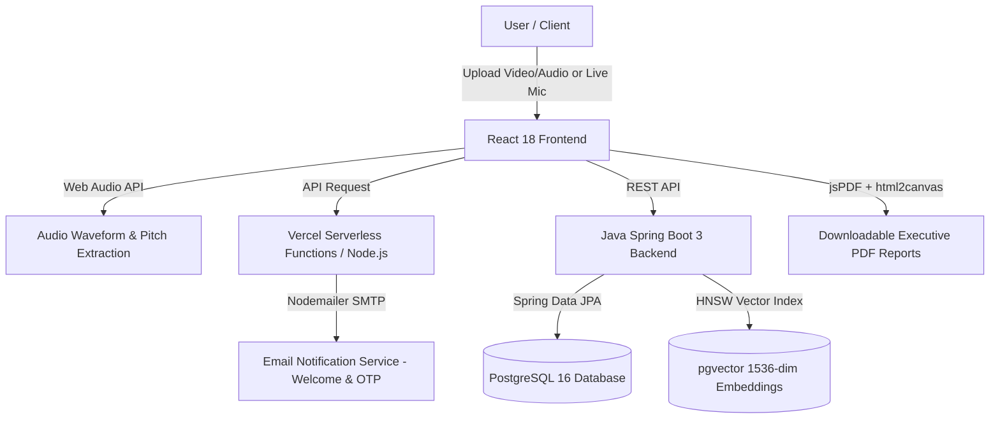

# 🎙️ Presentation Evaluator

> **Analyze. Improve. Succeed.**  
> An AI-powered speech & presentation evaluation platform that transforms speakers through automated cadence tracking, filler word detection, visual slide analysis, and executive PDF reporting.

[](https://react.dev/)
[](https://www.typescriptlang.org/)
[](https://vitejs.dev/)
[](https://tailwindcss.com/)
[](https://spring.io/projects/spring-boot)
[](https://www.postgresql.org/)
[](LICENSE)
[](https://presentation-evaluator.vercel.app)

---

## 📑 Table of Contents

- [Problem Statement](#-problem-statement)
- [The Solution](#-the-solution)
- [Executive Overview](#-executive-overview)
- [Key Features](#-key-features)
- [System Architecture](#-system-architecture)
- [Technology Stack](#-technology-stack)
- [Project Directory Structure](#-project-directory-structure)
- [Getting Started](#-getting-started)
  - [Prerequisites](#prerequisites)
  - [Frontend Setup](#1-frontend-setup-react--vite)
  - [Backend Setup](#2-backend-setup-spring-boot)
  - [Database Setup](#3-database-setup-postgresql--pgvector)
- [Environment Variables](#-environment-variables)
- [AI Speech & Signal Pipeline](#-ai-speech--signal-pipeline)
- [Executive PDF Report Engine](#-executive-pdf-report-engine)
- [API Reference](#-api-reference)
- [Deployment](#-deployment)
- [Authors & Acknowledgments](#-authors--acknowledgments)

---

## 📌 Problem Statement

Public speaking, student project defenses, business pitches, and technical conference presentations are essential skills for career advancement. However, mastering presentation delivery remains a persistent challenge due to critical industry gaps:

1. **Inaccessible & Expensive Coaching**: Professional speech coaches and presentation workshops typically cost hundreds of dollars per hour, making expert feedback inaccessible to students and early-stage professionals.
2. **Text-Only Tools Miss Delivery**: Conventional tools only evaluate written grammar or spelling. They completely overlook **how** a person presents—such as speech pace, nervous hesitation, filler word habits (`um`, `like`), and voice modulation.
3. **Subjective & Unstructured Feedback**: Practicing in front of a mirror or peers yields vague, subjective impressions with zero quantitative data or performance benchmarks.
4. **Disconnected Slide Auditing**: Most evaluation workflows separate speech from visual slides, leading to text-heavy slides, poor typography contrast, and disconnected verbal narratives.
5. **AI Hallucinations on Voiceless Media**: Generic AI platforms often evaluate silent or muted video uploads without verifying if human speech actually occurred, generating misleading, hallucinated scores.

---

## 💡 The Solution: Presentation Evaluator

**Presentation Evaluator** is an automated multimodal AI presentation coach and slide visual auditor that delivers instant, objective, and quantitative delivery analytics directly in the browser:

- **Client-Side Audio Signal Processing**: Uses the native **Web Audio API** to decode raw PCM audio frames in browser memory, measuring real-time Words-Per-Minute (WPM) cadence, pause ratios, and vocal energy without expensive server-side transcode latency.
- **Voice Activity & Anti-Hallucination Guard**: Employs RMS volume energy thresholding and syllabic peak modulation to verify active speech, instantly rejecting silent, muted, or non-presentation media before AI scoring.
- **Computer Vision Slide Detection**: Automatically samples video frames using an off-screen HTML5 Canvas to detect scene transitions, dynamically count all slides, and compute local visual readability and balance metrics.
- **Multimodal AI Coaching (Google Gemini 1.5 Flash)**: Generates bespoke, presentation-specific slide evaluations with unique titles, "What Went Well" strengths, and "What to Improve" coaching roadmaps tailored to the exact presentation topic.
- **Certified Executive PDF Reports**: Exports multi-page, vector-sharp audit reports (`jsPDF`) complete with performance badges, filler breakdowns, and certified audit stamps.

---

## 🎯 Executive Overview

In traditional speech coaching, speakers rarely receive objective, quantitative metrics on their delivery. Rehearsing presentations with human coaches is costly, slow, and subjective. 

**Presentation Evaluator** solves this problem by providing an automated AI evaluation laboratory. By uploading a video/audio recording or speaking live into a browser microphone, users instantly receive:
- **Pacing cadence velocity** benchmarked against keynote standards (125–150 WPM).
- **Filler word frequency** and hesitation pause analysis (`um`, `uh`, `like`, `you know`).
- **Visual slide density** and balance scoring.
- **Actionable AI coaching tips** categorized by Delivery, Content, Clarity, and Engagement.
- **Exportable branded executive PDF reports** with overall score badges and analytics.

---

## ✨ Key Features

### 1. Multi-Modal Media Ingestion
- **Video & Audio Upload**: Accepts `.mp4`, `.mov`, `.webm`, `.mp3`, `.wav`, `.m4a`, and `.ogg` formats.
- **Live Mic Rehearsal**: Built-in real-time browser microphone recorder with live waveform visualization using the Web Audio API (`AudioContext`, `AnalyserNode`).
- **Preloaded Sample Presets**: Instant evaluation demo presets for quick testing and demonstrations.

### 2. Speech Science & Cadence Analytics
- **Dynamic WPM Timeline**: Real-time Words-Per-Minute cadence tracking displayed via interactive Recharts line charts with optimal keynote boundary zones.
- **Filler Word Detection**: Identifies and counts speech crutches (`um`, `uh`, `like`, `actually`, `basically`) with hesitation pause durations.
- **Pitch Stability & Vocal Modulation**: Evaluates frequency modulation to prevent monotone delivery.

### 3. Comprehensive Evaluation Pillars
Every presentation is scored across six distinct pillars:
| Pillar | Focus Area |
| :--- | :--- |
| **Delivery & Confidence** | Vocal presence, hesitation control, and posture |
| **Content & Structure** | Narrative flow, clear introduction, and key takeaway hooks |
| **Visuals & Slide Design** | Information density, bullet-point readability, and slide clutter |
| **Pacing & Rhythm** | WPM consistency against 125–150 WPM keynote standard |
| **Vocal Clarity** | Articulation, volume balance, and diction quality |
| **Audience Engagement** | Persuasive rhetorical devices and energetic tone |

### 4. Executive PDF Report Generation
- Client-side vector-quality PDF generation powered by `jsPDF` and `html2canvas`.
- Includes **Overall Score Badge**, **Tier Classification** (e.g., *Top 5% Speaker Tier*), **Key Strengths**, **Priority Improvements**, and **Detailed Metric Breakdowns**.
- Clean, multi-page layout designed to prevent page-break cuts across sections.

### 5. Speaker Profile Dashboard & History
- Track long-term speaking progression, historical presentations, and average performance scores.
- Archive, search, and preview previously generated PDF audit reports.

### 6. Authentication & Security
- Firebase Authentication with email/password and secure session persistence.
- Dynamic password validation rules on registration.
- 6-digit OTP verification email workflow using Vercel Serverless Functions and Nodemailer (Gmail SMTP).

### 7. Responsive & Theme-Aware UI
- Modern Glassmorphism design system built with Tailwind CSS.
- One-click Light and Dark mode switching.
- 100% mobile-responsive layout with slide-out navigation drawers and zero horizontal overflow.

---

## 🏗️ System Architecture



---

## 🛠️ Technology Stack

### Frontend
- **Framework:** React 18 (Hooks, Context API)
- **Language:** TypeScript 5.7
- **Styling:** Tailwind CSS 3.4, PostCSS, Lucide React Icons
- **Bundler:** Vite 6
- **Data Visualization:** Recharts
- **PDF Engine:** jsPDF, html2canvas
- **Animations:** Canvas Confetti, Tailwind Animations

### Backend & Serverless
- **Serverless Endpoints:** Node.js Vercel Serverless Functions (`/api/send-otp`, `/api/send-welcome`)
- **Email Delivery:** Nodemailer (Gmail SMTP TLS)
- **Core Backend Framework:** Java 21, Spring Boot 3.3
- **Data Persistence:** Spring Data JPA, Hibernate ORM
- **Security & Networking:** Spring Security, CORS configuration

### Database & Vector Search
- **Primary Database:** PostgreSQL 16
- **Vector Search Engine:** `pgvector` extension (Cosine similarity `<=>`, HNSW indexing)
- **Containerization:** Docker & Docker Compose

---

## 📁 Project Directory Structure

```text
presentation-evaluator/
├── api/                          # Vercel Serverless Functions
│   ├── send-otp.js               # 6-digit verification code email delivery
│   └── send-welcome.js           # New user registration welcome email delivery
├── backend/                      # Java Spring Boot 3 Backend
│   ├── src/main/java/com/presentation/evaluator/
│   │   ├── config/               # CorsConfig, SecurityConfig
│   │   ├── controller/           # AuthController, EvaluationController, VectorSearchController
│   │   ├── dto/                  # Request & Response Data Transfer Objects
│   │   ├── entity/               # UserEntity, EvaluationEntity, TranscriptSegmentEntity
│   │   ├── repository/           # Spring Data JPA Repositories (pgvector queries)
│   │   └── service/              # Business logic & AI speech calculation services
│   ├── src/main/resources/       # application.yml configuration
│   └── pom.xml                   # Maven dependencies (Java 21, Spring Boot 3.3)
├── database/                     # Database schemas & configurations
│   ├── docker-compose.yml        # PostgreSQL 16 + pgvector container definition
│   ├── schema.sql                # DDL tables & pgvector index creation
│   └── README.md                 # Database setup instructions
├── public/                       # Static public assets & brand logo
├── src/                          # Frontend React Codebase
│   ├── components/               # Modular UI Components
│   │   ├── auth/                 # LoginForm, RegisterForm, ForgotPasswordModal
│   │   ├── common/               # IntroAnimation, AuthToastNotification
│   │   ├── dashboard/            # Dashboard (Upload Hub, Audio Player, Pacing)
│   │   ├── evaluation/           # EvaluationResultView (Charts & Scores)
│   │   ├── landing/              # LandingPage (Hero banner, Feature grid)
│   │   ├── layout/               # Navbar, Sidebar, Footer, Mobile Drawer
│   │   ├── profile/              # ProfileDashboardView, RecentPresentations, Settings
│   │   └── reports/              # ReportPreviewModal (PDF rendering engine)
│   ├── context/                  # AuthContext, EvaluationContext, ThemeContext
│   ├── services/                 # api.ts (Backend communication client)
│   ├── types/                    # TypeScript interfaces & domain types
│   ├── utils/                    # mockData, mediaStore, audioProcessing
│   ├── App.tsx                   # Top-level routing & layout controller
│   ├── index.css                 # Global Tailwind utilities & viewport bounds
│   └── main.tsx                  # React DOM root entry point
├── package.json                  # Frontend dependencies & scripts
├── tailwind.config.js            # Tailwind theme customization & color tokens
├── tsconfig.json                 # TypeScript compiler configuration
├── vercel.json                   # Vercel deployment routes & function rewrites
└── vite.config.ts                # Vite build and plugin configuration
```

---

## 🚀 Getting Started

### Prerequisites
Make sure the following tools are installed on your machine:
- **Node.js**: v18.0.0 or higher ([Download](https://nodejs.org/))
- **npm**: v9.0.0 or higher
- **Java JDK**: 21 LTS (if running the Spring Boot backend)
- **Docker & Docker Compose**: (if running local PostgreSQL + pgvector)

---

### 1. Frontend Setup (React + Vite)

1. **Clone the repository:**
   ```bash
   git clone https://github.com/saipoojithabadineedi/presentation-evaluator.git
   cd presentation-evaluator
   ```

2. **Install frontend dependencies:**
   ```bash
   npm install
   ```

3. **Configure Environment Variables:**
   Copy `.env.example` to `.env`:
   ```bash
   cp .env.example .env
   ```
   Fill in your Firebase credentials and backend API URLs (see [Environment Variables](#-environment-variables)).

4. **Start the local development server:**
   ```bash
   npm run dev
   ```
   Open your browser at `http://localhost:5173`.

5. **Build for production:**
   ```bash
   npm run build
   ```

---

### 2. Backend Setup (Spring Boot)

1. **Navigate to the backend directory:**
   ```bash
   cd backend
   ```

2. **Configure database credentials:**
   Edit `src/main/resources/application.yml` with your PostgreSQL username, password, and URL.

3. **Run the Spring Boot application:**
   ```bash
   ./mvnw spring-boot:run
   ```
   The backend API will start at `http://localhost:8080/api/v1`.

---

### 3. Database Setup (PostgreSQL + pgvector)

1. **Navigate to the database directory:**
   ```bash
   cd database
   ```

2. **Launch the PostgreSQL 16 + pgvector container:**
   ```bash
   docker compose up -d
   ```

3. **Verify database connection:**
   - Host: `localhost:5432`
   - Database: `presentation_db`
   - Username: `postgres`
   - Password: `password`
   - The initial schema from `schema.sql` creates tables and initializes the `pgvector` extension automatically.

---

## 🔐 Environment Variables

Create a `.env` file in the root directory with the following configuration:

```env
# ==========================================
# Frontend Configuration
# ==========================================
VITE_API_BASE_URL=http://localhost:8080/api/v1

# ==========================================
# Firebase Authentication
# ==========================================
VITE_FIREBASE_API_KEY=your_firebase_api_key
VITE_FIREBASE_AUTH_DOMAIN=your_project.firebaseapp.com
VITE_FIREBASE_PROJECT_ID=your_project_id
VITE_FIREBASE_STORAGE_BUCKET=your_project.appspot.com
VITE_FIREBASE_MESSAGING_SENDER_ID=your_messaging_sender_id
VITE_FIREBASE_APP_ID=your_app_id

# ==========================================
# Email Notification Service (Serverless)
# ==========================================
EMAIL_USER=presentationevaluator2@gmail.com
EMAIL_PASS=your_gmail_app_password
```

> [!NOTE]
> `EMAIL_PASS` requires a 16-character **Google App Password** generated from your Google Account security settings with 2-Step Verification enabled.

---

## 📊 AI Speech & Signal Pipeline

The presentation evaluation pipeline operates across four distinct stages:

```
[Audio / Video File]
       │
       ▼
1. Web Audio Ingestion ──────► Decodes raw audio via AudioContext & AnalyserNode
       │
       ▼
2. Cadence Velocity ─────────► Computes WPM (Words Per Minute) across timestamps
       │
       ▼
3. Filler Word Classifier ───► Detects "um", "uh", "like", and pause durations
       │
       ▼
4. Synthesis Engine ─────────► Generates Overall Score %, Speaker Tier, & Recommendations
```

- **Optimal Keynote Standard:** Evaluated against 125–150 WPM. Speeches falling within this range receive highest pacing scores.
- **Hesitation Index:** Tracks pauses longer than 2.0 seconds and correlates them with filler word spikes.

---

## 📄 Executive PDF Report Engine

The application includes an executive-grade PDF generator built on `jsPDF` and `html2canvas`:

- **Dedicated Page Geometry:** Configured for standard A4 document sizing (`210mm x 297mm`).
- **Score Header & Watermark:** Prominently displays the verified Overall Score badge (70%–98%) alongside presentation metadata.
- **Clean Sectional Breakdown:** Formats metric scores, speech graphs, key strengths, and prioritized coaching tips without awkward page-break cuts.
- **Single-Click Download:** Instant client-side download with zero external server dependencies.

---

## 🌐 API Reference

### Serverless Email Endpoints (Vercel)

| Method | Endpoint | Description |
| :--- | :--- | :--- |
| `POST` | `/api/send-welcome` | Sends HTML welcome onboarding email upon registration |
| `POST` | `/api/send-otp` | Delivers 6-digit verification code for password reset |

### Core Backend Endpoints (Spring Boot)

| Method | Endpoint | Description |
| :--- | :--- | :--- |
| `POST` | `/api/v1/auth/register` | Registers a new user account |
| `POST` | `/api/v1/auth/login` | Authenticates user credentials |
| `POST` | `/api/v1/evaluations/analyze` | Submits media file for full AI evaluation |
| `GET` | `/api/v1/evaluations/{id}` | Retrieves detailed scores for a rehearsal |
| `GET` | `/api/v1/evaluations/user/{userId}` | Lists historical evaluations for profile |
| `POST` | `/api/v1/vectors/search` | Performs cosine similarity search using pgvector |

---

## 🚀 Deployment

The production frontend and serverless API are deployed on **Vercel**:

- **Production URL:** [https://presentation-evaluator.vercel.app](https://presentation-evaluator.vercel.app)
- **Automatic CI/CD:** Connected to the `main` branch of `saipoojithabadineedi/presentation-evaluator`. Any push to `main` triggers automated build and deployment.

---

## 👥 Authors & Acknowledgments

- **Team Pro** — Rajiv Gandhi University of Knowledge Technologies (RGUKT Ongole)
- **Repository Maintainer:** [@saipoojithabadineedi](https://github.com/saipoojithabadineedi)
- Built with precision for students, educators, executives, and speakers worldwide.

---

<p align="center">
  <sub>© 2026 Presentation Evaluator. All rights reserved.</sub>
</p>